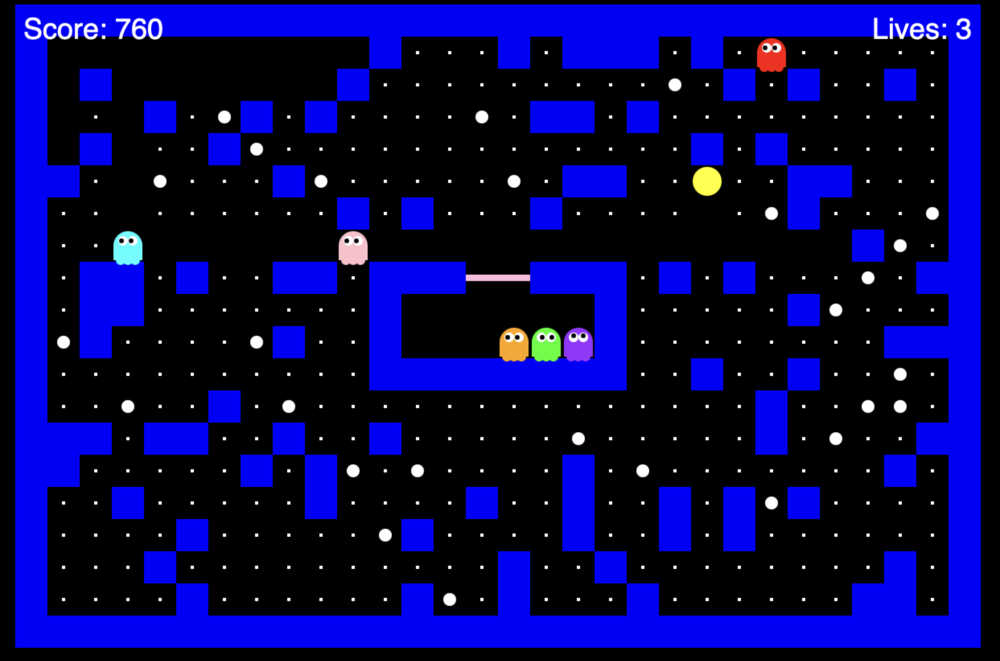

# PAC-MAN

The Pac-Man application is a reimplementation of the famous vintage game.

## Approach

Here the idea is to start from an existing implementation in Python and to ask the model to reimplement it as single file browser only application. This approach should test the skill in case of a migration to a different implemetation stack.

## Prompt

The detailed prompts are [generation](../../prompts/pacman.generation.md) and [verification](../../prompts/pacman.verification.md)

## Preview

### Documentation

- [Codex version documentation](./by-codex-gpt-6/README.md)
- [Qwen 3.8 version documentation](./by-qwen3.8-27b-4bit/README.md) 
- [Qwen 3.8 flash next version documentation](./qwen3.8-flash-next-4bit/README.md)

## Document History
| Date | Author | Description | 
|------|--------|-------------|
| 2026-10-02 | Daniele Denti | The reference implementation was done first using Codex GPT-6 Astra and finished by GitHub Copilot. |
| 2026-10-08 | Daniele Denti | The implementation was split in two phases, code generation and test generation, using different sessions. |
| 2026-10-11 | Daniele Denti | Detailed test suite generation plan based on the verification prompt. |