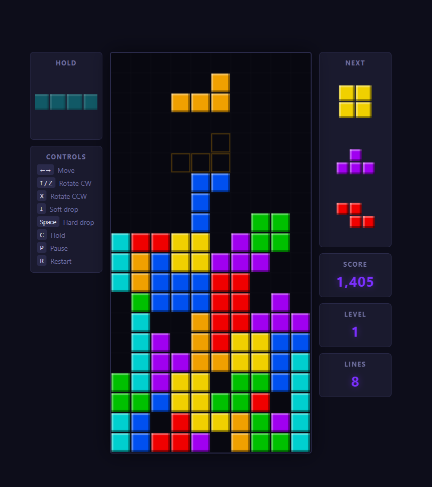

# Tetris

The Tetris application is an MVP implementation of the classic block-stacking game, built to demonstrate core gameplay mechanics, playability, and prompt-driven development in a compact format. It is intended as a practical example of how a single prompt can produce a working game with only limited post-generation refinements.

## Table of Contents

- [Approach](#approach)
- [Prompt](#prompt)
- [Preview](#preview)
- [Documentation](#documentation)

## Approach

Initially it was used to demonstrate the capabilities of artificial intelligence and was oriented towards frontier models, then became a simple way to catalogue local models, distinguishing between those that were actually usable and those that generated too many errors or took too long. Being a simple game with well-defined moves, it was also fairly easy to replicate. Local models are permitted to refer to the reference implementation but are asked to generate the code from scratch using their own abilities.

### Prompt

"*Build a complete Tetris game with standard rules: a 10x20 playfield, seven tetromino types, line clearing mechanics, and increasing difficulty. Include controls for moving, rotating, soft/hard dropping pieces, and holding a piece. Implement scoring based on lines cleared and levels that increase fall speed. Ensure the game ends when the stack reaches the top. Provide a clean UI with on-screen stats (score, level) and options to pause/restart. Keep the code clean and modular and ship a playable, balanced MVP.*"

### Generation History

This application is available in seven versions: 
- generated by **Claude Sonnet 4.6** (strong graphical presentation and design). 
- generated by **GPT-5.3-codex** (equally valid in gameplay terms, but with a slightly rougher presentation).
- generated by **Gemini Pro 3.1** (graphically solid, though not at Sonnet's level, but the only version that required no post-generation edits).
- generated by **Qwen 3 Coder**.
- generated by **Gemma 4**.
- generated by **Ornith 1.0**.
- generated by **Qwen 3.8 flash next** 

### Preview

#### Documentation

- [Codex version documentation](./by-codex/README.md)
- [Gemma 4 version documentation](./by-gemma4:31b-nvfp4/README.md)
- [Gemini version documentation](./by-gemini/README.md)
- [Ornith 1.0 version documentation](./by-ornith-1.0-35b/README.md)
- [Qwen3-Coder version documentation](./by-qwen3-coder/README.md)
- [Qwen3.8-flash-next version documentation](./by-qwen3.8-flash-next/README.md)
- [Sonnet version documentation](./by-sonnet/README.md)

### History

| Date | Author | Description |
|------|--------|-------------|
| 2026-05-26 | Daniele Denti | The project is extended to include models run locally through Ollama. The hardware used is a MacBook Pro M4 Max with 64 GB of memory, running macOS Tahoe. |
| 2026-06-07 | Daniele Denti | Systematic testing of models suitable for local use began. At this stage, Ollama, VS Code, and GitHub Copilot were used. The first model tested is **Qwen3-coder:30b**, made available by Alibaba. The outcome is very good, although a number of additional prompts are required to correct errors and functional issues. Overall, this local model produced a working implementation with a strong visual design, even though it took longer to complete. Even so, building Tetris in this way remained far quicker and more efficient than writing all the code by hand. |
| 2026-06-09 | Daniele Denti | The first model that meets the speed and quality requirements for local use is **gemma4:31b-nvfp4**. |
| 2026-07-08 | Daniele Denti | The **Ornith-1.0-35B-4bit** model produced the best overall implementation of Tetris in less than 10 minutes. |
| 2026-09-24 | Daniele Denti | The **qwen3.8-flash-next:4bit** model generate a very good and compact implementation of the game in a long run (one hour). The implementation is accurate and doesn't have any errors. The reason for the long run is the approach of the Slotstream engine, which loads only the necessary parts of the model from the disk. Here the bottleneck is the reading speed of the SSD; this approach makes it possible to run bigger models on hardware with a limited amount of RAM. |